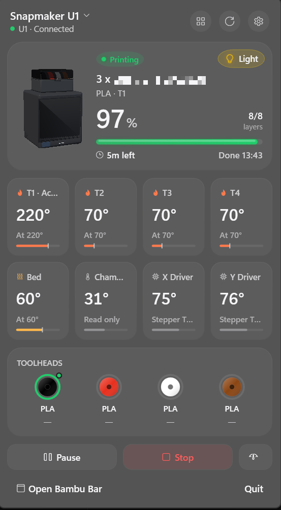
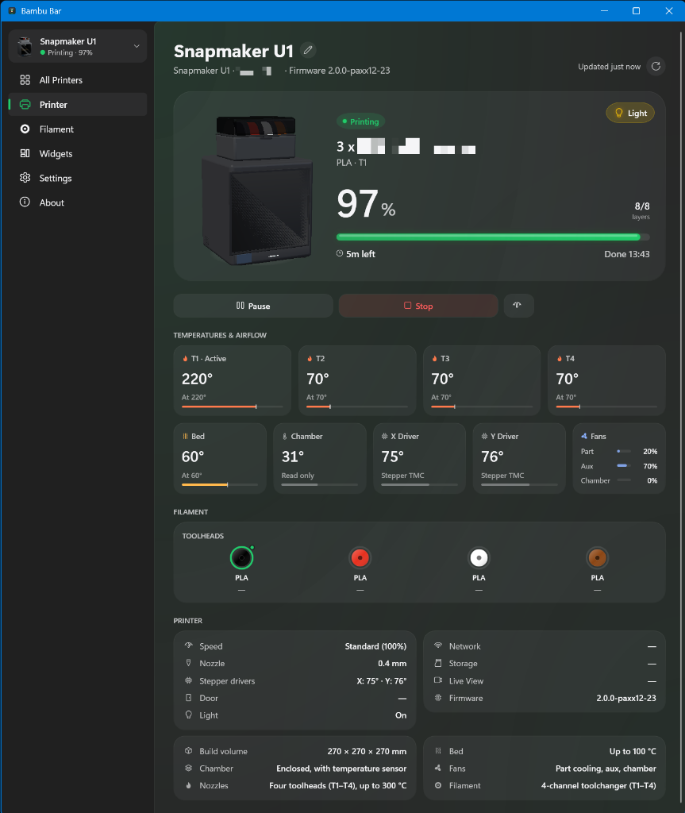

# 3DPrinter Bar for Windows

**Your Bambu Lab and Snapmaker U1 / Klipper 3D printers, one click away in the Windows notification area.**

This is an enhanced fork of [Bambu Bar for Windows](https://github.com/Precog29/bambu-bar-windows) (originally ported from [Bambu Bar](https://github.com/rolottr/bambu-bar) for macOS by rolottr). In addition to **Bambu Lab (LAN)** printers, it adds native support for the **Snapmaker U1** running [paxx12 Extended Firmware](https://github.com/paxx12/SnapmakerU1-Extended-Firmware) (and other **Fluidd / Moonraker / Klipper** printers), live 4-toolhead filament tracking, and multi-printer **All Active Printers** views.

Built with C#, .NET 10 and WPF. No account, no cloud service, no analytics.

[What's New](#whats-new-in-this-fork) · [Getting started](#getting-started) · [Features](#features) · [Widgets](#desktop-widgets) · [Building](#building-from-source)

> Independent, community-developed software. Not affiliated with or endorsed by Bambu Lab or Snapmaker. Supports Bambu Lab LAN printers (X1, P1, A1, H2, and P2S families) as well as Klipper/Moonraker/Fluidd printers including the Snapmaker U1.

| Tray Flyout Panel | Main Window (Overview) |
| :---: | :---: |
|  |  |

## What's New in This Fork

- **Snapmaker U1 (`paxx12` Firmware) & Fluidd / Moonraker Support:** Connect directly to your Snapmaker U1 or Klipper printer over Moonraker's WebSocket (`ws://<ip>/websocket`) and HTTP JSON-RPC API (auto-detecting port `80` and `7125`), with optional Moonraker API key support.
- **All 4 Toolhead (`T1`–`T4`) & X/Y Stepper Driver Temperatures:** Displays dedicated temperature & target gauges for all 4 toolheads (`T1 · Active`, `T2`, `T3`, `T4`) alongside Bed, Chamber (`temperature_sensor cavity`), and `tmc2240 stepper_x` / `tmc2240 stepper_y` driver temperatures.
- **Live 4-Toolhead Filament Tracking (`T1`–`T4`):** Reads the Snapmaker U1's `print_task_config`, `filament_detect`, and `filament_feed left`/`right` Klipper objects to display exact loaded filament colors (with human-readable color names), brands (`SUNLU`, `Generic`, etc.), materials, RFID tag weights/temperature ranges, and active toolhead state under a dedicated **Toolheads** section instead of "AMS".
- **Display All Active Printers Everywhere:**
  - **Tray Flyout:** Defaults to showing all printers at once, with a 1-click **Active / All** toggle when multiple printers are configured.
  - **All Printers Page:** Includes an **Active / All** filter pill in the header to focus only on printers currently printing, preparing, paused, or needing attention.
  - **All Active Printers Desktop Widget:** Add a single floating desktop widget that dynamically lists every active printer with its job name, state badge, filament swatch, percentage, and remaining time.
- **Full Print & Hardware Controls over Moonraker:** Pause, resume, cancel print, change speed profile (`M220`), and toggle the chamber/cavity LED (`led cavity_led`).

## Features

| | What you get |
| --- | --- |
| **Tray icon** | A printer glyph that fills as the print grows, with a pause or alert mark when the printer needs you. Choose to show the percentage or the time left in the icon instead; hover it for the job, progress, time left and finish time. |
| **Panel** | Click the icon: view all your printers (or filter to **Active** only), or inspect a single printer's job, stage ("Heating hotend", "Paused: filament ran out"), percentage, layers, time left and finish time; nozzle, bed and chamber/cavity temperatures; AMS spools or **Toolheads (`T1`–`T4`)**; printer errors; pause, resume, stop, speed and chamber light. Frosted acrylic on Windows 11. |
| **Right-click menu** | Open the window, switch printers, refresh, pause, resume, stop, the chamber light, settings, check for updates, quit. |
| **Grams left** | Bambu Lab spools tell the AMS their net weight, so the app shows filament left in grams (≈ 810 g), not just a percentage, and how much you have on hand in total. |
| **Named filament & live toolhead colors** | Bambu Lab spools show their colour by name (Grass Green, Charcoal). Snapmaker U1 toolheads (`T1`–`T4`) read their live RGBA hex colours, human-readable colour names (Black, Red, White, Brown…), brands and materials directly from Klipper's `print_task_config` and `filament_detect`. |
| **3D printer models** | The same Blender models as the Mac app, as live 3D you can turn with the mouse (double-click to reset): the print grows layer by layer in the filament's colour, the bed drops (or the A1's gantry rises), the toolhead moves while printing, the spools take their real colours and the chamber light follows the printer's. |
| **Knows your model** | Includes profiles for Bambu Lab printers (X1, P1, A1, H2, P2S) plus **Snapmaker U1** (`SM-U1`) and **Fluidd Klipper** (`KLIPPER`), showing dual/multi-nozzle temperatures, cavity/chamber sensors, and fans supported by each machine. |
| **Window** | Printer, Filament, Widgets, Settings and About pages, plus All Printers with more than one, on Windows 11's Mica backdrop. Follows Windows' light or dark mode. |
| **Many printers** | All of them watched at once. Filter by **Active** or **All**, with printers that need attention listed first (failed, paused), then by soonest finish. Choose which one the tray icon shows, or let it pick whichever is busy. |
| **Desktop widgets** | Small, medium and large per-printer widgets, plus a unified **All Active Printers** widget that shows every busy printer in one compact desktop card. |
| **Notifications** | Windows notifications when a print finishes, fails or is canceled, pauses (filament runout and the like), for new printer errors, and optionally when a print starts. Click one to see that printer. |
| **Easy setup** | Choose between **Bambu Lab (LAN)** or **Snapmaker U1 / Fluidd** right on the setup page. For Bambu printers, auto-discovers on the LAN and imports access codes from Bambu Studio or OrcaSlicer. For Snapmaker U1 / Fluidd, just enter the printer's IP address. |
| **Windows integration** | Open at sign-in (starts in the tray only), one copy at a time (opening it again shows the window), keyboard shortcuts, and it follows the printer when DHCP gives it a new address. |

## Getting started

### Requirements

- **Windows 10 (version 1809) or Windows 11**, x64 or ARM64. Acrylic and Mica need Windows 11; Windows 10 gets solid backgrounds.
- One or more **Bambu Lab** printers or **Snapmaker U1 (paxx12 Extended Firmware) / Klipper (Fluidd / Moonraker)** printers on the same local network as the PC.

### Install and connect

1. Download `BambuBar-x64.exe` (or `BambuBar-arm64.exe`) from [Releases](../../releases) — or [build it yourself](#building-from-source) — and put it somewhere permanent.
2. Open it. The first time, **Windows Defender Firewall asks whether Bambu Bar may use the network: allow it on private networks.**
3. **Adding a Snapmaker U1 or Fluidd / Klipper printer:**
   - Select **Snapmaker U1 / Fluidd** at the top of the setup page.
   - Enter your printer's IP address (e.g. `192.168.1.78`, or `192.168.1.78:7125` if Moonraker is on a custom port), pick **Snapmaker U1** (or **Fluidd Klipper**), and optionally enter a Moonraker API Key if your setup requires authentication.
   - Click **Connect**.
4. **Adding a Bambu Lab printer:**
   - Select **Bambu Lab (LAN)** at the top of the setup page.
   - Pick your discovered printer from the list (or enter its IP and Serial Number).
   - The **access code** usually fills itself in if Bambu Studio or OrcaSlicer on this PC has used the printer. Otherwise read the 8-character **Access Code** from **Settings → Network** on the printer's screen.
   - Click **Connect**.

Windows hides new tray icons in the overflow (^). To keep the icon visible, drag it onto the taskbar, or turn it on in **Settings → Personalization → Taskbar → Other system tray icons**.

### Controlling prints

- **Snapmaker U1 / Fluidd (Moonraker):** Pause, resume, cancel print, speed changes (`M220`), and cavity/chamber LED control work directly over Moonraker's HTTP/WebSocket API.
- **Bambu Lab (LAN):** Reading status works in any mode. Pause, resume, stop and speed changes are accepted only when the printer is in **LAN Only** mode with **Developer Mode** on (printer screen → Settings → Network). The chamber light works either way.

## Desktop widgets

- **All Active Printers:** A unified multi-printer widget that lists every currently active printer (printing, preparing, paused, or needing attention) with progress, state indicator, filament color swatch, and remaining time.
- **Small:** a progress ring with the percentage, time left, the filament going in, and the finish time and layers. Paused, it says why; finished, how long ago and how long it took; idle, the temperatures and loaded spools.
- **Medium:** the printer with the part growing in the filament's colour, the job and its progress, finish time, layers and temperatures.
- **Large:** everything: temperature tiles, every AMS/Toolhead spool with what's left, the newest error in plain words and how the last print went.

Add widgets from the **Widgets** page (or the tray's right-click menu → Widgets…), then drag them where you want them. **Right-click** a widget to switch between **All Active Printers** or a specific printer, change its size, or keep it above other windows.

## Differences from the Mac app

Everything the Mac app does, the Windows app does; a few things work the Windows way:

| macOS | Windows |
| --- | --- |
| Menu bar item with text beside the glyph | Tray icon. The **While printing, show** setting draws the percentage or time left in the icon itself (a tray icon is one small square); the tooltip always has the full line. |
| Menu bar panel | Flyout above the tray icon, acrylic on Windows 11. |
| App menu bar (Printer menu, Check for Updates…) | The tray icon's right-click menu. |
| WidgetKit widgets on the desktop and in Notification Center | Desktop widget windows (see above). |
| Keychain | Windows Credential Manager. |
| Login Items | The `Run` key in the registry. If you switch it off in **Settings → Apps → Startup** or Task Manager, Bambu Bar's settings say so and link there. |
| `~/Library/Application Support/Bambu Bar` | `%APPDATA%\Bambu Bar` (settings, print history, widget places). Set `BAMBUBAR_DATA_DIR` to use another folder. |
| `⌘` shortcuts | `Ctrl` shortcuts (below). |

## Keyboard shortcuts

| Shortcut | Action |
| --- | --- |
| `Ctrl+0` | All Printers (with more than one). |
| `Ctrl+1` – `Ctrl+5` | Printer, Filament, Widgets, Settings, About. |
| `Ctrl+R` | Ask the printer for a full report. |
| `Ctrl+L` | Turn the chamber light on or off. |
| `Ctrl+,` | Settings. |
| `Ctrl+W` | Close the window (keeps running in the tray). |

In the tray panel: `Ctrl+O` opens the window, `Ctrl+Q` quits, `Esc` closes the panel.

## How it works

- **Snapmaker U1 & Fluidd / Moonraker printers:** Connects to Moonraker over HTTP (`/printer/info`, `/printer/objects/list`, `/printer/objects/query`) and subscribes to live status updates via WebSocket (`ws://<host>/websocket` using JSON-RPC `printer.objects.subscribe`). Automatically reads Klipper's `print_stats`, `virtual_sdcard`, `extruder`–`extruder3`, `heater_bed`, `temperature_sensor cavity`, `led cavity_led`, `print_task_config`, `filament_detect`, and `filament_feed left`/`right`.
- **Bambu Lab printers:** Connects to the printer's MQTT broker on port 8883 over TLS 1.2 as `bblp` with the access code, verifying that its certificate chains to Bambu Lab's certificate authorities and matches the printer's serial number. Discovers printers via SSDP on UDP port 2021.

## Privacy and local storage

No account, no analytics, no cloud. The app talks only to your printers on your local network.

- **Printers, preferences, window and widget places:** `%APPDATA%\Bambu Bar\settings.json`.
- **Access codes / API keys:** Windows Credential Manager.
- **Last prints** (only what the app saw while running): `%APPDATA%\Bambu Bar\history.json`.

## Building from source

Requirements: the [.NET 10 SDK](https://dotnet.microsoft.com/download). Windows to run it; the core library and its tests also build and run on Linux and macOS.

```powershell
git clone https://github.com/Madnessx9/3DPrinter-bar-windows.git
cd 3DPrinter-bar-windows
dotnet build BambuBar.slnx                                  # debug build
dotnet run --project src\BambuBar                           # run it
dotnet publish src\BambuBar -c Release -r win-x64 -o publish # one self-contained BambuBar.exe
dotnet test tests\BambuBar.Core.Tests                       # unit tests, plus live runs against the emulator
```

The emulator tests need `mosquitto` and `openssl` on the PATH (on Linux, `apt install mosquitto mosquitto-clients`); without them they're skipped.

The [GitHub Actions workflow](.github/workflows/build.yml) runs the tests on Linux, builds on Windows, renders snapshots of every page in light and dark from the demo printer (download them from the run's artifacts), and publishes `BambuBar-x64.exe` and `BambuBar-arm64.exe`. Pushing a `v*` tag attaches them to a release.

### Layout

- `src/BambuBar.Core`: everything that isn't Windows UI: the MQTT client and TLS check, report parsing, discovery, slicer import, the printer store, history, settings, updates, the demo printer. Ported from the Mac app's Swift sources and tested on any OS.
- `src/BambuBar`: the WPF app: tray icon, flyout, window and pages, widgets, 3D models, notifications, Credential Manager, start at sign-in.
- `tests/BambuBar.Core.Tests`: xUnit tests, including TLS/MQTT runs against `scripts/emulator`.
- `tools/convert-models.py` converts the Mac app's USDZ printer models to the meshes the app loads; `tools/generate-icon.py` draws the app icon.

### Developing without a printer

- `--demo [printing|preparing|paused|finished|failed|idle|offline|unconfigured]` runs a simulated P2S; add `--fleet` for six printers. Nothing is saved and no network is used. `--dark` and `--light` force either look.
- `scripts/emulator/printer.py` runs a pretend P2S on `127.0.0.1:8883` (needs mosquitto): a TLS MQTT broker that replays a real P2S report, then prints, heats and obeys pause, resume, stop, speed and light. Connect with `BambuBar.exe --connect 127.0.0.1 22E00EMULATOR0 12345678 --insecure-tls`.
- `scripts\fleet\run.ps1` starts a mock fleet of 12 printers in Docker Desktop and opens Bambu Bar against it with `--emulator`. `-Import` starts on the Add Printer page to try **Add All**, `$env:SSDP=1` has the printers announce their names and models, `-Stop` stops it.
- `--probe <ip> <serial> <access-code|saved> [seconds] [--raw-filament]` connects to a printer from a terminal and prints what it reports (`saved` uses the code Bambu Bar saved). Pipe it to see the output wait for the end: `BambuBar.exe --probe 192.168.1.50 01P00A000000000 saved | Out-Host`.
- `--snapshot <dir>` (with `--demo`) writes PNGs of the panel, widgets, every page and the tray icon's states, then quits.

## Credits and license

[Bambu Bar](https://github.com/rolottr/bambu-bar) was created by [rolottr](https://github.com/rolottr); this Windows port follows its design and sources. Released under the [MIT License](LICENSE).

Protocol details, a real P2S report and the English HMS error texts come from [ha-bambulab](https://github.com/greghesp/ha-bambulab) (MIT), which also provided Bambu Lab's certificate authorities that ship with the app. [Bambuddy](https://github.com/maziggy/bambuddy) and [bambu-cli](https://github.com/tobiasbischoff/bambu-cli) helped map the newer printers, and the access-code import follows [Bambu Studio](https://github.com/bambulab/BambuStudio)'s settings format. Each model's capabilities follow the printer profiles in Bambu Studio.

The printer models were built for the Mac app in Blender from published outer dimensions; they are visual approximations, not manufacturer CAD, and carry no logos.

Bambu Lab, Bambu Studio, Bambu Handy, AMS and P2S are trademarks of Bambu Lab. This project is not affiliated with Bambu Lab.
